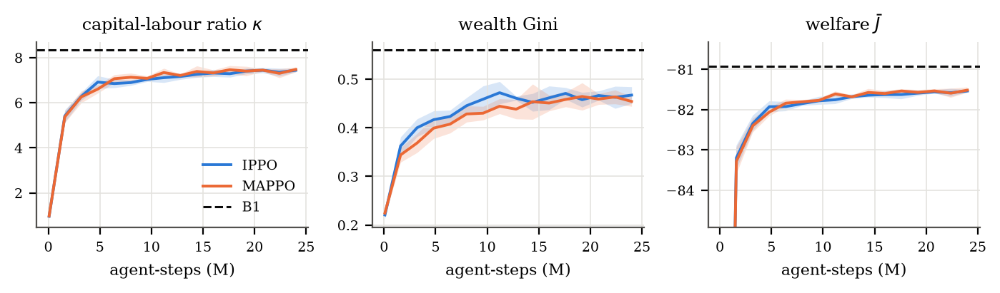
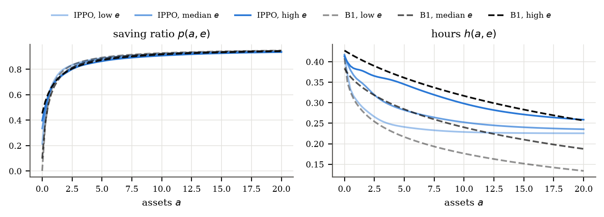
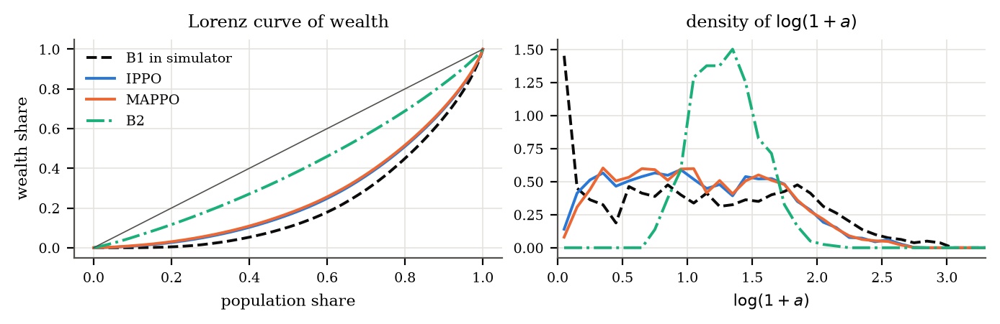
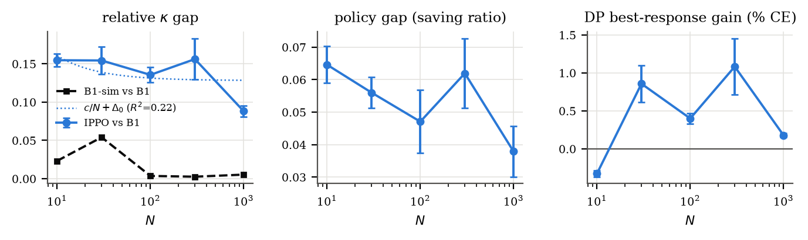
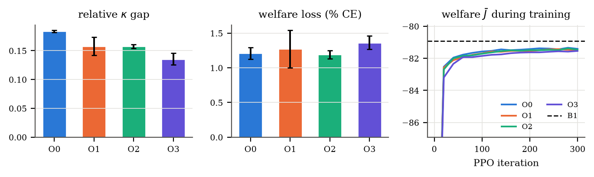
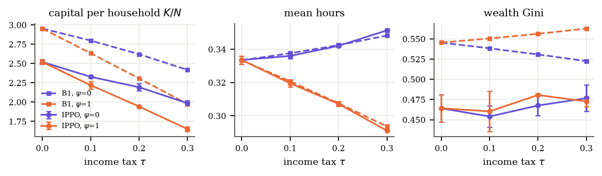
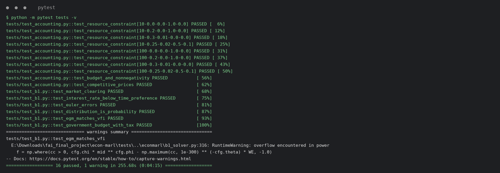
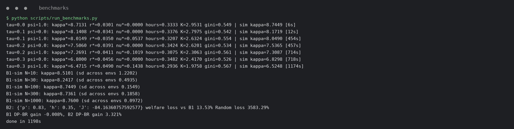
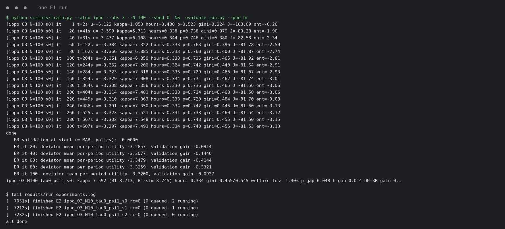

# Learning to Work and Save in a Shared Economy

**Decentralized MARL versus the known-model Aiyagari equilibrium.** FAI final project, Group 42:
Aryan Meshram (24110054), Chaitanya Sharma (23110072), Pratik Kumar Dhakar (24110277), Saksham Chourasia (24110312).

We simulate a finite-N Bewley–Huggett–Aiyagari economy in which every household chooses a saving ratio and hours
each period, with income tax and a lump-sum rebate. We solve the **same** economy exactly with a dynamic-programming
benchmark (B1), train shared-policy **IPPO** and **MAPPO** households in it, and measure how far the learned economy is
from the competitive equilibrium. The gaps we measure cover aggregates, individual policies, welfare, inequality and
exploitability.

**Final report:** [`report/FAI_Group42_final.tex`](report/FAI_Group42_final.tex) (8 pages, PRIMEarxiv template).
`report/main.tex` with `report/sections/` is an earlier, longer draft of the same paper and is not the submission.

## Headline results

| (N = 100, τ = 0, 5 seeds) | κ = K/L | hours | wealth Gini | welfare loss vs B1 | DP best-response gain |
|---|---|---|---|---|---|
| B1 theory (N = ∞) | 8.713 | 0.333 | 0.549 | – | – |
| B1 executed in simulator | 8.745 | 0.333 | 0.545 | 0 | −0.01 % |
| B2 best constant policy | 7.985 | 0.350 | 0.196 | 13.53 % | 3.32 % |
| **IPPO** | 7.53 ± 0.09 | 0.334 | 0.46 ± 0.02 | **1.36 ± 0.10 %** | 0.40 ± 0.07 % |
| **MAPPO** | 7.56 ± 0.12 | 0.334 | 0.45 ± 0.01 | **1.30 ± 0.19 %** | 0.42 ± 0.13 % |

* **E1:** learners match equilibrium hours exactly and come within 1.4 % of equilibrium welfare. They under-accumulate
  capital by about 14 %, generate too little wealth inequality, and remain exploitable: the exact best response gains
  0.4 %, while a PPO-trained deviator finds about 0 %.
* **E2 (N = 10 … 1000):** the capital gap does not shrink like 1/N. It sits on a learning floor of about 13 %
  (fit R² = 0.22). At N = 10 the price-taking B1 policy is beaten by the learners.
* **E3 (observations O0–O3):** observing prices cuts the capital gap from 18.4 % to 15.8 % and exploitability from 0.81 % to 0.49 %.
  Observing aggregates adds nothing, and TaxAI-style group statistics help a little.
* **E4 (τ ∈ {0, .1, .2, .3}, revenue wasted or rebated):** learners reproduce the signs of the equilibrium responses
  of capital and hours, and roughly their elasticities. They do not reproduce the inequality response.

All numbers are written to `results/summary.json` and `report/tables/*.tex` by `scripts/make_report_assets.py`.

## Figures

| | |
|---|---|
|  E1 learning curves |  E1 policy functions |
|  E1 wealth distribution |  E2 population size |
|  E3 observation levels |  E4 tax responses |

### Screenshots of the runs

Terminal logs of the test suite, the benchmark solver and the experiment launcher (rendered from `results/*.log` by `scripts/make_screenshots.py`):





## Setup

```bash
python -m venv .venv && source .venv/bin/activate   # Windows: .venv\Scripts\activate
pip install -r requirements.txt
```

Tested with Python 3.11.9, numpy 2.4, scipy 1.17, torch 2.14 (CPU only), and matplotlib 3.11.

## Reproducing everything

```bash
pytest tests -v                                   # 16 tests: accounting identities, B1 equilibrium, EGM vs VFI (~4 min)
python scripts/calibrate.py                       # chi and initial wealth -> results/calibration.json
python scripts/run_benchmarks.py                  # B1 for 7 tax regimes, B1-in-simulator, B2, Random (~20 min)
python scripts/run_experiments.py --parallel 5    # 49 training runs + evaluation, resumable (~2 h on 12 cores)
python scripts/make_report_assets.py              # summary.json, LaTeX tables, figures
```

To reproduce a single run and its numbers:

```bash
python scripts/train.py --algo ippo --obs 3 --N 100 --seed 0 --tau 0 --psi 1
python scripts/evaluate_run.py results/runs/ippo_O3_N100_tau0_psi1_s0 --ppo_br
```

Every run folder in `results/runs/<algo>_O<obs>_N<N>_tau<τ>_psi<ψ>_s<seed>/` contains:

* `model.pt`: actor and critic weights.
* `config.json` and `history.json`: the run configuration and the training curve.
* `log.txt`: the training log.
* `eval.json`: every evaluation metric.

The trained models of all 49 runs are committed, so `evaluate_run.py` and `make_report_assets.py` can be rerun
without retraining. Runs are seeded. Reruns should match up to the floating-point nondeterminism of multi-threaded
PyTorch.

**Checking the paper's numbers (about 1 minute, no retraining):** run `python scripts/make_report_assets.py`, then
`git status`. It rebuilds `report/tables/*.tex` and `results/summary.json` from the stored `eval.json` files, and these
come out byte-identical to the committed versions. The tables in the report are copies of `report/tables/*.tex`.
Figure PDFs differ only in their embedded creation timestamp.

## Compiling the report

Upload the `report/` folder to Overleaf (or zip it and use *New Project → Upload Project*), set **Main document** to
`FAI_Group42_final.tex`, and compile with pdfLaTeX. It uses `PRIMEarxiv.sty` from the same folder and standard
packages only (amsmath, booktabs, graphicx, algorithm/algpseudocode, caption, placeins, hyperref).

## Repository layout

```
econmarl/
  config.py         economic parameters (EconConfig)
  markov.py         Rouwenhorst productivity chain (shared by simulator and B1)
  tax.py            HSV income tax, asset tax
  env.py            C1  vectorized [M, N] simulator with exact accounting
  obs.py            observation levels O0-O3, global summary for the MAPPO critic
  b1_solver.py      C2  EGM household + Young histogram + Brent equilibrium, VFI cross-check
  baselines.py      C3  B1-in-simulator, B2 best constant policy, Random
  ppo.py            C4  shared-policy IPPO / MAPPO with Beta policies
  evaluate.py       C5  common-random-number rollouts, welfare, Gini, consumption equivalents
  metrics.py        C5/C6 policy gaps, convergence, DP best response, exploitability
  best_response.py  C6  single-deviator PPO best response
  bench_cache.py    cache of solved equilibria
scripts/            calibrate, train, evaluate_run, run_benchmarks, run_experiments, make_report_assets
tests/              test_accounting.py (10 tests), test_b1.py (6 tests)
results/            benchmarks.json, summary.json, runs/ (49 runs), tune/ (learning-rate tuning)
figures/            PNG figures;  report/figures: PDF versions used in the paper
report/             FAI_Group42_final.tex (submitted report), PRIMEarxiv.sty, tables/ and figures/ (generated);
                    main.tex + sections/ (earlier draft), arxiv.sty (fallback style)
```

## Reference

Q. Mi et al. *TaxAI: A Dynamic Economic Simulator and Benchmark for Multi-Agent Reinforcement Learning.* AAMAS 2024.
Our simulator follows TaxAI's household block; our contribution is the exact equilibrium benchmark and the gap analysis.
